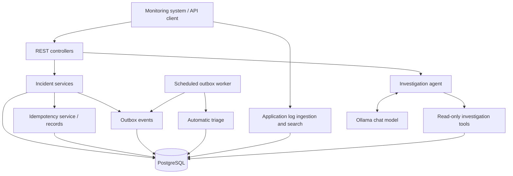
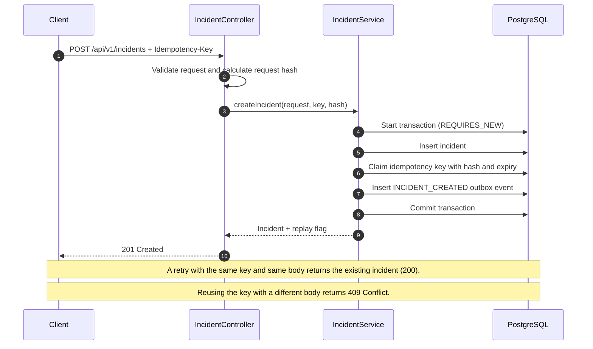
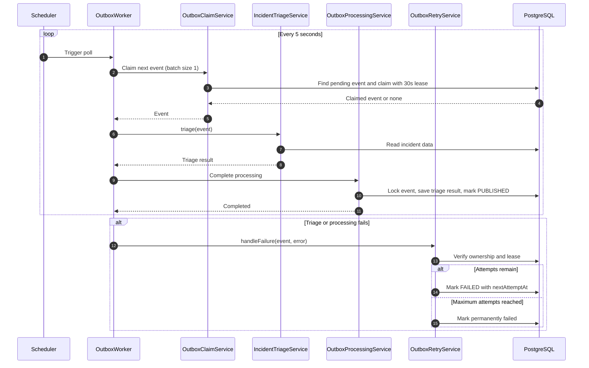
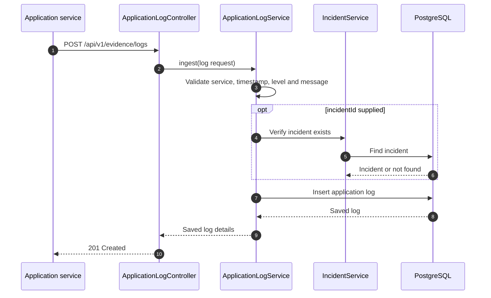
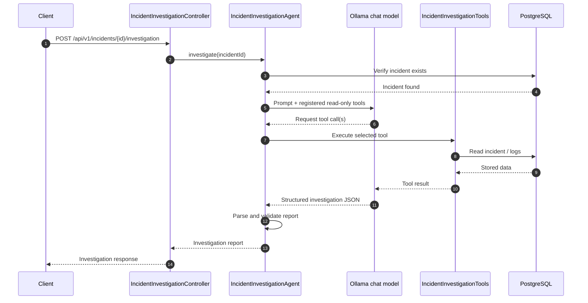

# SignalOps

**AI-assisted incident management and investigation platform**

SignalOps is a backend-focused project for receiving service alerts, tracking incidents, processing incident events asynchronously, collecting application-log evidence, and using an LLM to help investigate incidents.

The project is being built as a **modular monolith** with clear boundaries between its REST API, domain services, persistence, background processing, and AI investigation capabilities. The goal is to make incident workflows observable, explainable, and useful to an engineer investigating a production issue.

> **Project status:** This README describes the features currently represented in the codebase. Items in the roadmap are plans, not claims about existing functionality. Update this document as implementation changes.

---

## Table of contents

- [Capabilities](#capabilities)
- [Architecture](#architecture)
- [Execution flows](#execution-flows)
  - [1. Incident creation](#1-incident-creation)
  - [2. Asynchronous outbox processing and triage](#2-asynchronous-outbox-processing-and-triage)
  - [3. Application log ingestion](#3-application-log-ingestion)
  - [4. AI-assisted investigation](#4-ai-assisted-investigation)
- [Incident lifecycle](#incident-lifecycle)
- [API overview](#api-overview)
- [Technology stack](#technology-stack)
- [Run locally](#run-locally)
- [Authentication (local Keycloak)](#authentication-local-keycloak)
- [Configuration notes](#configuration-notes)
- [Design decisions](#design-decisions)
- [Roadmap](#roadmap)

## Capabilities

- **Incident ingestion:** create incidents through a REST API.
- **Idempotent requests:** use an `Idempotency-Key` to avoid creating duplicate incidents when a client retries a request.
- **Transactional outbox:** persist the incident and its `INCIDENT_CREATED` event together.
- **Background processing:** a scheduled worker claims outbox events and runs automatic triage.
- **Retry handling:** failed outbox processing is retried with an increasing delay and a bounded attempt count.
- **Incident lifecycle:** retrieve incidents, list/filter them, and update their status.
- **Application-log evidence:** ingest structured application logs and search a bounded time window around an incident.
- **AI-assisted investigation:** ask an LLM to assemble a structured investigation from incident details, age analysis, and stored log evidence.

## Architecture

SignalOps is a modular monolith. The modules are deployed together, but responsibilities are separated so that HTTP handling, business rules, asynchronous work, evidence retrieval, and AI orchestration do not become one large controller.



### Main responsibilities

| Area | Responsibility |
|---|---|
| Incident REST API | Accept incident requests and expose incident operations |
| Incident service | Apply incident business rules and coordinate persistence |
| Idempotency records | Recognize retries and detect reuse of a key with a different request |
| Outbox | Store events that must be processed after the incident transaction commits |
| Outbox worker | Poll for pending events, claim them, and coordinate triage |
| Application-log service | Validate, persist, and query structured application logs |
| Investigation agent | Orchestrate an LLM investigation and parse the structured response |
| Investigation tools | Give the model controlled, read-only access to SignalOps data |

## Execution flows

These diagrams show the intended successful execution path based on the current implementation. Failure paths are included where they affect the system's behavior.

### 1. Incident creation

The client sends an incident request with an `Idempotency-Key`. The incident, idempotency record, and outbox event are persisted in the same database transaction. This prevents the system from committing an incident without also recording the event that should trigger downstream processing.



**Important behavior**

- A new request returns `201 Created`.
- A replay with the same idempotency key and same request body returns the existing incident with `200 OK` and the `Idempotency-Replayed` response header.
- Reusing the same key with a different request body returns `409 Conflict`.
- Idempotency records are currently configured with a seven-day expiry.
- The outbox event is written in the incident-creation transaction. The background worker does not need to run before the API responds.

### 2. Asynchronous outbox processing and triage

The outbox worker runs independently of the request/response path. It polls on a five-second fixed delay and processes up to ten events per poll, claiming one event at a time. A claimed event receives a processing lease so that processing ownership is bounded.



**Current processing behavior**

- Poll interval: five seconds.
- Maximum events per poll: ten.
- Claim size: one event at a time.
- Processing lease: 30 seconds.
- Retry delay increases exponentially based on the attempt count.
- The configured maximum attempt count is five.
- On successful processing, saving the triage result and marking the outbox event as published happen transactionally.
- Automatic triage is background processing triggered by the outbox event. It is separate from the explicitly requested AI investigation endpoint.

### 3. Application log ingestion

Services can send structured application logs to SignalOps. The service validates the log fields and stores the record in PostgreSQL. Logs are searchable by the service associated with an incident.



**Investigation search behavior**

- The incident's `source` value is used as the service name to search.
- The time window is 15 minutes before through 15 minutes after incident creation.
- At most 50 matching records are returned, newest first.
- Supported levels: `TRACE`, `DEBUG`, `INFO`, `WARN`, and `ERROR`.
- The optional `incidentId` on an ingested log is validated against an existing incident.

### 4. AI-assisted investigation

An engineer can explicitly request an investigation for an incident. The agent checks that the incident exists, builds the LLM interaction, and registers read-only investigation tools. The model decides which registered tools to call; the precise tool-call order can vary by model response.



The registered tools currently provide:

1. **Incident details** — retrieve stored incident information.
2. **Incident age analysis** — calculate incident age and whether it exceeds the configured 30-minute overdue threshold.
3. **Application log search** — retrieve up to 50 matching logs from the bounded time window.

The investigation response is structured around:

- `summary`
- `observedFacts`
- `hypotheses`
- `evidenceGaps`
- `recommendedSeverity`
- `nextSteps`

**Investigation guardrails**

- Tool access is read-only; the agent does not change incident state or perform remediation.
- Stored data and log messages are evidence, not instructions to the model.
- The model should distinguish observed facts from hypotheses and unknowns.
- It must not claim access to metrics, traces, deployments, or other systems that are not connected.
- Incident age or an absence of evidence alone should not justify increasing severity.
- A severity recommendation should be supported by specific evidence; otherwise, the stored severity should be retained.

## MCP server

SignalOps can expose selected incident capabilities to MCP-compatible clients through a **Streamable HTTP MCP server**. The MCP adapter is a transport boundary: it delegates to the existing incident services, log-evidence service, and investigation agent rather than duplicating domain logic.

### Exposed tools

| MCP tool | Purpose | Access |
|---|---|---|
| `list_incidents` | List incidents, optionally filtered by status | Read-only |
| `get_incident` | Retrieve stored incident details by UUID | Read-only |
| `get_incident_logs` | Search bounded application-log evidence for an incident | Read-only |
| `investigate_incident` | Run the existing AI investigation and return its structured report | Read-only |

The log search retains the existing service/time-window/result-limit rules. The investigation tool invokes the existing LLM-backed agent; it does not create a second agent or mutate incident state.

### Enable locally

MCP is disabled by default. Start the application with the `local` Spring profile to enable the Streamable HTTP transport:

```bash
SPRING_PROFILES_ACTIVE=local ./mvnw spring-boot:run
```

The MCP endpoint uses Spring AI's default `/mcp` path unless changed by configuration. Configure your MCP client to connect to `http://localhost:8080/mcp` when the application is running on its default port.

**Security:** Spring AI's HTTP MCP transport does not add authentication by itself. Keep this endpoint bound to a trusted local environment for this initial implementation. Do not expose it to a public network until authentication and authorization are added.

### Design boundary

- REST remains the primary application API.
- MCP tools are thin adapters over existing application services.
- Only read operations are exposed; no status update, incident creation, replay, or remediation tool is registered.
- Tool arguments are validated at the adapter boundary and domain-level not-found behavior is delegated to existing services.

## Incident lifecycle

The incident model currently includes these statuses:

- `OPEN`
- `ACKNOWLEDGED`
- `INVESTIGATING`
- `RESOLVED`

Status changes are handled through the incident status API and validated against the application's allowed transitions. An invalid transition is returned as a conflict.

Severity values:

- `LOW`
- `MEDIUM`
- `HIGH`
- `CRITICAL`

## API overview

Base path: `/api/v1`

| Method | Endpoint | Purpose |
|---|---|---|
| `POST` | `/incidents` | Create an incident (requires `Idempotency-Key`) |
| `GET` | `/incidents` | List incidents; supports an optional `status` filter |
| `GET` | `/incidents/{incidentId}` | Retrieve one incident |
| `PATCH` | `/incidents/{incidentId}/status` | Update incident status |
| `GET` | `/incidents/{incidentId}/triage` | Retrieve the latest triage result |
| `POST` | `/incidents/{incidentId}/investigation` | Run an AI-assisted investigation |
| `POST` | `/evidence/logs` | Ingest an application log |

Actuator endpoints are configured for health, info, and metrics. Check the active application configuration for the exact management base path and exposure settings.

## Technology stack

| Concern | Technology |
|---|---|
| Language | Java (project targets Java 21) |
| Framework | Spring Boot |
| Persistence | Spring Data JPA, Hibernate |
| Database | PostgreSQL |
| Schema migrations | Flyway |
| AI orchestration | Spring AI |
| Local model runtime | Ollama |
| Build | Maven Wrapper |
| Operational endpoints | Spring Boot Actuator |

## Run locally

The commands below assume you have Java, PostgreSQL, and Ollama installed and configured for the project.

1. Clone the repository:

   ```bash
   git clone https://github.com/roastedcoder/signalops-core.git
   cd signalops-core
   ```

2. Configure the database connection and AI model settings in the application's configuration. Make sure the PostgreSQL database exists and is reachable.

3. Start PostgreSQL and Ollama. Pull the model configured by the application if it is not already available locally.

4. Start the application:

   **macOS / Linux**
   ```bash
   ./mvnw spring-boot:run
   ```

   **Windows**
   ```powershell
   .\mvnw.cmd spring-boot:run
   ```

5. Check the application health endpoint using the management path configured in the application.

> Exact database credentials, model settings, and management endpoint exposure are configuration-dependent. Do not commit local secrets to the repository.

## Authentication (local Keycloak)

SignalOps acts as an OAuth2 resource server. Keycloak authenticates users and issues JWT access tokens; SignalOps validates the token signature, issuer, and time claims. The application does not store passwords or create login sessions.

### Start the local identity provider

Set local bootstrap credentials in your shell. Do not commit them to the repository or put them in a checked-in `.env` file:

```bash
export KEYCLOAK_ADMIN_USERNAME="your-local-admin-name"
read -s KEYCLOAK_ADMIN_PASSWORD
export KEYCLOAK_ADMIN_PASSWORD
docker compose up -d
```

Keycloak is bound to `127.0.0.1:8180`. The imported realm defines the local test client and the `signalops-operator` and `signalops-admin` realm roles, but intentionally does not import users or passwords.

Open the Keycloak Admin Console at `http://localhost:8180`, sign in with the bootstrap credentials, select the `signalops` realm, and create a local test user. Set a password in the Credentials tab and assign the `signalops-operator` realm role under Role mapping. Use a unique password that is not used anywhere else.

### Start SignalOps

```bash
SPRING_PROFILES_ACTIVE=local ./mvnw spring-boot:run
```

The resource server expects the issuer `http://localhost:8180/realms/signalops`. Override it with `KEYCLOAK_ISSUER_URI` in another environment.

### Obtain a local access token

For local CLI smoke testing, the imported public client enables the OAuth2 Resource Owner Password Credentials grant. Supply the test user's credentials interactively; do not put passwords in shell history:

```bash
read -r -p "Keycloak username: " KEYCLOAK_USERNAME
read -s -p "Keycloak password: " KEYCLOAK_PASSWORD
echo
curl -X POST http://localhost:8180/realms/signalops/protocol/openid-connect/token \
  -H "Content-Type: application/x-www-form-urlencoded" \
  --data-urlencode "client_id=signalops-local" \
  --data-urlencode "grant_type=password" \
  --data-urlencode "username=$KEYCLOAK_USERNAME" \
  --data-urlencode "password=$KEYCLOAK_PASSWORD"
unset KEYCLOAK_PASSWORD
```

Copy the returned `access_token` and use it as a bearer token:

```bash
curl http://localhost:8080/api/v1/incidents \
  -H "Authorization: Bearer <access_token>"
```

The password grant is included only to make local CLI testing straightforward. Production user-facing clients should use Authorization Code with PKCE; service-to-service clients should use an appropriate confidential-client flow.

### Role-based authorization

The resource server reads Keycloak's `realm_access.roles` claim and maps each realm role to a Spring Security authority (for example, `signalops-operator` becomes `ROLE_signalops-operator`). OAuth2 scope authorities are preserved.

Protected routes, including REST and the MCP endpoint, require either the `signalops-operator` or `signalops-admin` realm role. Both roles currently have the same route access because the application does not yet contain separate administrator-only operations. A valid JWT without either role is authenticated but forbidden (HTTP 403).

### Current security boundary

- `/actuator/health` is public for health probes.
- All other routes require a valid bearer JWT containing at least one supported SignalOps realm role.
- Keycloak realm roles in `realm_access.roles` are mapped to Spring authorities with the `ROLE_` prefix. OAuth2 scope authorities are retained.
- `signalops-operator` and `signalops-admin` currently grant access to protected application and MCP routes. The application does not yet define separate admin-only operations.
- This authentication/authorization milestone does **not** yet enforce tenant-level data isolation.
- Do not expose the service or MCP endpoint publicly until tenant isolation and production identity-provider configuration are completed.

## Configuration notes

Before running the application, review `src/main/resources/application.yaml` and configure:

- PostgreSQL URL, username, and password for your local environment.
- Spring AI model provider and model name.
- Ollama host and model availability.
- Any management endpoint settings required for local health checks.

Keep credentials and API keys outside version control. Use environment-specific configuration or environment variables for secrets.

## Design decisions

### Why a modular monolith?

The current project is small enough to run as one application. A modular monolith keeps deployment and local development simple while allowing responsibilities to remain separated. Splitting into microservices would add operational complexity without a demonstrated need.

### Why a transactional outbox?

The incident and the event that triggers downstream processing are committed together. This avoids the failure mode where an incident is saved but publishing its event is lost because a separate operation fails.

### Why idempotency?

HTTP clients and upstream monitoring systems may retry requests after timeouts or network failures. An idempotency key lets SignalOps recognize a retry and return the original incident rather than creating another one. The request hash also detects a key reused with a different payload.

### Why read-only AI tools?

The investigation agent is intended to assist an engineer, not autonomously change production state. Read-only tools constrain the model to gathering evidence and producing recommendations for human review.

## Roadmap

Planned work may include:

- A protected administrative workflow for replaying permanently failed outbox events.
- Better retry classification, including transient versus permanent failures and provider retry hints.
- Cursor-based incident pagination.
- Additional evidence sources such as metrics, traces, and deployment information.
- An MCP server adapter that exposes selected SignalOps capabilities to compatible AI clients.
- A minimal incident dashboard.
- Expanded automated tests and operational documentation.

Roadmap items are not necessarily implemented in the current codebase.

---

## Keeping this README current

When changing the system, update the corresponding section:

- New endpoint → API overview and request/response examples.
- New table or relationship → database design and relevant flow.
- New worker or event → outbox execution flow.
- New investigation tool → AI investigation flow and guardrails.
- New dependency or configuration → technology stack and local setup.

Prefer documenting **what the code currently does** separately from **why the design was chosen** and **what is planned next**. This keeps the README useful as both project documentation and an interview discussion guide.
